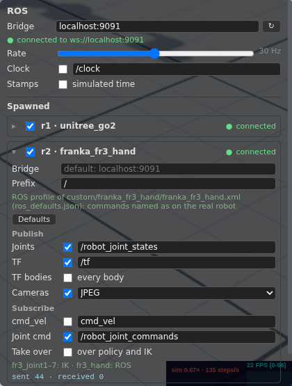

# ROS bridge

ROS goes through rosbridge (rosbridge_suite's WebSocket protocol, no
roslibjs), from this browser, in local and network mode alike, set up in
the **ROS** panel (top right; `public/js/ros/`: `bridge.js` one WebSocket
per address, `robot.js` the world's setup and each robot's, `rospanel.js`).



On top what belongs to the world, once: the default **bridge** address
(`localhost:9090` until changed, or a `ws://` / `wss://` URL) with its
state (retried every 2 s while it is down; ↻ connects again), the **rate**
every robot's joint states and TF go out at (1–60 Hz, 30 by default),
**Clock** and **Stamps**. Stamps are wall time in ROS 2's form (`sec`,
`nanosec`), or with **Stamps: simulated time** the simulation's; **Clock**
publishes the simulated time on `/clock` (`rosgraph_msgs/Clock`, on the
default bridge only) for nodes with `use_sim_time`, while a robot's ROS is on.

Below, everything spawned (robots, environments and objects) with its own
switch and state; unfolded, its settings:

- **Bridge**: empty for the default one, or an address of its own. Robots
  on one address share one WebSocket.
- **Prefix**: the robot's id by default (`r1`, `r2`, or typed in; `/` for
  none), before every name, so robots of one model on one bridge do not
  overwrite each other: the topics not starting with `/` (`r1/joint_states`,
  `r1/joint_command`, `r1/cmd_vel`, `r1/wrist_cam/image_raw/compressed`;
  `/tf` stays shared) and the TF frames (`r1/base_link`,
  `r1/wrist_cam_optical_frame`; the roots still in `world`). Joint names in
  the messages stay plain. For one robot with robot_state_publisher, set it
  to `/` or use its `frame_prefix`.
- The ROS profile it uses (below) and **Defaults**.
- Published: the joint states (`sensor_msgs/JointState` on `joint_states`:
  the robot's hinge and slide joints, names without the `r1/` prefix, with
  velocities and efforts, `qfrc_actuator`: the actuators' force on each
  joint; in network mode the page asks the server to add them to its states
  while a robot is on, op `dynamics`) and TF (`tf2_msgs/TFMessage` on
  `/tf`: every body in its parent's frame, the root bodies in `world`;
  **TF bodies** off leaves the bodies out when robot_state_publisher
  computes them from a URDF, the cameras' optical frames still go).
- **Cameras**: each camera of the robot switched on in the Cameras panel
  (and ticked here) is published every frame it renders (its own rate):
  `<camera>/image_raw/compressed` (`sensor_msgs/CompressedImage`, JPEG, the
  default) or `<camera>/image_raw` (`sensor_msgs/Image`, `rgb8`), and
  `<camera>/camera_info` (`sensor_msgs/CameraInfo`: a pinhole of its
  vertical field of view, fx = fy = (h/2)/tan(fovy/2), centered, no
  distortion); with TF on, also `<camera>_optical_frame` (z forward, x
  right, y down) in its link's frame. Frames are dropped while the
  WebSocket is more than 8 MB behind (counted).
- Subscribed, both into the drive layer (`public/js/drive/drive.js`, which also
  takes the Teleop panel's keys and goals): `cmd_vel`
  (`geometry_msgs/Twist`: linear x / y and angular z drive the walking
  policy or the base like the keys do, before the keys and a goal; one
  older than 0.5 s counts as none; the panel says when there is nothing to
  drive, with a link to the Teleop panel) and joint commands
  (`sensor_msgs/JointState` on `joint_command`: position targets for the
  actuators on those joints). A joint a switched-on policy, base or IK
  drives stays theirs; the commands move the others. With **Take over**
  they move those too while they come (written over what the controllers
  wrote before every physics step; 0.5 s after the last one the controllers
  have them back; the server does the same in network mode). The line
  below says who writes which joints (`fr3_joint1–7: IK · fr3_hand: ROS`),
  as the Teleop panel does.

Settings stay in this browser: the world's, and per robot file its topics,
switches and its own address if it has one (the prefix per robot, for this
page's life); a robot's ROS is switched on in the panel each time. (The
settings of before, all per robot file, are split once: an address saved
the same for every file becomes the default, differing ones stay those
files' own.) A page on HTTPS (GitHub Pages, Binder) may still connect to
`ws://localhost`; browsers treat localhost as secure.

**Shared world**: one browser publishes a robot. The server keeps, per
robot, which browser holds its ROS (the one that switched it on, op
`ros_hold`, until it switches it off or leaves) and tells every browser
(`ros` messages); in the others the robot shows *held elsewhere* and its
switch is off limits, so its joint states do not go out twice. `/clock` is
held the same way (the first browser with Clock on and a robot on).

## ROS profiles: named like the real robot

A robot file can have a profile in `public/json/ros_profiles.json` (keyed
like `json/ik_defaults.json`) so that programs written for the real robot work
unchanged: `settings` (defaults for the topics and switches above),
`prefix`, `joints` and `frames` (model name → ROS name; a joint mapped to
null is left out), `world` (the root bodies' parent frame), `commands`
(a ROS joint driven by an actuator: `{actuator, scale, offset}`, ctrl =
position · scale + offset, e.g. a gripper on a tendon) and `cameras`
(`{camera: {topic, frame}}`: the namespace of its `image_raw` /
`camera_info` and its optical frame, as the real driver names them; a
RealSense: `camera/camera/color`, `camera_color_optical_frame`). The ROS
panel says which profile a robot uses.

## ros2_control: the FR3 as franka_ros2 runs it

The library's **Franka FR3 with hand** (`custom/franka_fr3_hand`, assembled
from Menagerie's FR3 and its Panda's hand by the library's
`scripts/assemble_fr3_hand.py`) is named as franka_ros2 names the FR3
(`fr3_joint1`..`7`, `fr3_finger_joint1`/`2`, `fr3_hand_tcp`). Its profile
makes the lobby the hardware behind
[topic_based_ros2_control](https://github.com/PickNikRobotics/topic_based_ros2_control)'s
default topics: joint states on `/robot_joint_states`, commands from
`/robot_joint_commands` (the hand's `fr3_finger_joint1`, each finger's
opening in m, driving its actuator), no body TF (robot_state_publisher has
the URDF), no prefix. `server/ros/fr3/`:

- `fr3.urdf`: the kinematic tree with a `<ros2_control>` block on
  `topic_based_ros2_control/TopicBasedSystem` (position commands; position
  and velocity states; `fr3_finger_joint2` a mimic), made by
  `server/ros/mjcf2urdf.py` from the MJCF (any lobby robot:
  `--command` for joints driven through a profile's `commands`);
- `controllers.yaml`: joint state broadcaster, a joint trajectory
  controller for the arm (`/fr3_arm_controller/follow_joint_trajectory`),
  a parallel gripper controller for the hand (`/fr3_gripper/gripper_cmd`,
  `control_msgs/action/ParallelGripperCommand` in Jazzy);
- `fr3_lobby.launch.py`: robot_state_publisher, `ros2_control_node`, the
  spawners and rosbridge (`port:=9090`, `use_sim_time:=true` with the
  lobby's Clock and simulated stamps on);
- `demo.py`: a trajectory and gripper client as one would write for the
  real robot (home, a reach, close, open, home).

```sh
source /opt/ros/jazzy/setup.bash
ros2 launch server/ros/fr3/fr3_lobby.launch.py
# in the lobby: spawn Franka FR3 with hand; in the ROS panel switch it on
# (and tick Take over, or untick its IK in the Teleop panel)
python3 server/ros/fr3/demo.py
```

Needs (Jazzy) `ros-jazzy-rosbridge-suite`, `ros-jazzy-parallel-gripper-controller`,
the ros2_control packages of one version, and `topic_based_ros2_control`
built against it: its binary package (0.3.0) was built against ros2_control
4.38 and crashes loading the hardware with 4.48, so build it from source in
`ros_ws/` (ignored by git) and source that too:

```sh
git clone https://github.com/PickNikRobotics/topic_based_ros2_control ros_ws/src/topic_based_ros2_control
(cd ros_ws && source /opt/ros/jazzy/setup.bash && colcon build --cmake-args -DBUILD_TESTING=OFF)
source ros_ws/install/setup.bash
```

Tried (local mode, wall time, joint states at 30 Hz): `demo.py`'s
trajectories end within 0.02-0.03 rad of their goals (the controllers
report success; the arm's position servos hold against gravity with a
small offset), the hand closes to 0 and opens to 0.038 m.
