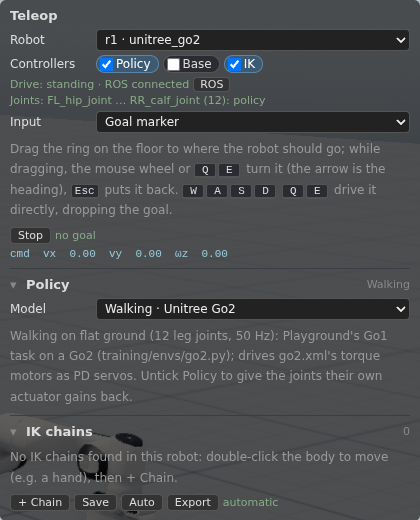

# Teleop panel and controllers

The Teleop panel (`public/js/drive/teleop.js`, open by default) picks which robot is
driven (the newest by default, or the one double-clicked; double-clicking
anything else releases it; the others get a zero command and stand or
brake) and which of its controllers are on: **Policy**, **Base**, **IK**,
any of them or none. The choice is saved per robot file
(`mujoco-filament/controllers/<path>`); by default a robot runs the policy
made for it (GR00T on every menagerie G1 variant, no compatibility check:
switched on elsewhere, a policy reports the missing joint), Base when a
mobile base was found, IK always. Switching a policy off gives the
actuators their own gains back, and an automatic IK setup is found again
around whatever the remaining controllers drive (a G1 without its policy
gets leg chains). Keyboard: **WASD** walk / drive, **QE** turn, hold
**R**/**F** to raise or lower a locomotion policy's base height (keys typed
into a text field are ignored); the sections fold. The Policy section also
has a control for each of the policy's other commands (Microduck's head
pose, GR00T's height; see Commands in `docs/policies.md`).



Under the controllers two lines say what drives the robot now (**Drive**:
ROS cmd_vel, the keys or gamepad, the goal marker, or standing) and who
writes which of its joints (**Joints**: a switched-on policy, base or IK
keeps the joints it drives, ROS joint commands write the others); **ROS**
opens the robot in the [ROS panel](ros.md). Both come from the drive
layer (`public/js/drive/drive.js`, no DOM): the panel's inputs (keys, gamepad,
the touch and WebXR sticks, the goal marker) push into it, as ROS does,
and every frame it writes each robot's walking policy or base command,
first source first: a fresh ROS `cmd_vel`, then the keys or sticks while
they drive, then the robot's goal; else a zero command. Goals are kept
there for every caller (the marker, `window.goals`, behaviour trees, the
Agent). Environments and objects are not listed (their ROS is in the ROS
panel).

The **Input** select picks the keys or a **goal marker** (the default,
`public/js/drive/goal.js`): an orange ring with a heading arrow, like the spawn
marker, that sits under the driven robot until it is dragged along the
floor (the mouse wheel or **Q**/**E** turn it while dragging, **Esc** puts
it back; a label by the pointer shows its position and heading). It is
drawn over everything, so a robot's base does not hide it. The robot then drives itself there, with the same twist command
the keys give and within their speeds, so a walking policy and a wheeled
base both follow it, in local and network mode: far off it turns towards
the goal and goes forward (a robot that cannot strafe backs up to a goal
just behind it), near it a mecanum base or a walking robot closes the rest
sideways, and at the point it turns to the goal heading (6 cm, 3.5°, with
hysteresis). A robot keeps going to its goal while another one is driven;
Reaching the goal lets it go (the readout says *arrived*; pushed or carried
off afterwards, the robot stays put). **Stop** forgets the goal, and so does Reset or driving it with the keys.

A **gamepad** (the Gamepad API's standard mapping, Xbox / PlayStation
layout; browsers report one once a button on it is pressed) drives too, in
any Input mode: its sticks walk and turn and take over from a goal like the
keys, which also do so in goal-marker mode. Two of its inputs close the
grippers of the driven robot's first and second IK chain as far as they
are pressed, like a WebXR trigger (let go: open). Its bindings are
`public/json/gamepad_defaults.json` (by default left stick walk, right
stick turn, d-pad up/down height, LT/RT the grippers); **Input → Gamepad**
(the only choice for a robot that does not walk but has IK chains) shows
them per action, **Set** binds the next button pressed or stick pushed,
changes are kept in the browser, **Defaults** goes back to the file and
**Export** copies them as JSON for it.
In network mode a robot has one goal for everyone: the server follows it
(`server/goal.py`), every client shows it, and the last one set wins.

Goals can also come from a script, for several robots at once:

- **In the page** (devtools console or page automation, local and network
  mode): `goals.move(which, {forward, left, turn})` sets each robot's goal
  relative to its own pose (m, rad), `goals.set(which, {x, y, yaw})` an
  absolute one, `goals.clear(which)` stops them, `await goals.wait(which)`
  resolves once all have arrived, `goals.list()` shows names, poses and
  goals. `which` is `'all'` (every robot whose walking policy or base is
  on), a name (`'r3'`), a label, or a list of those. E.g.
  `goals.move('all', {forward: 1}); await goals.wait('all'); goals.move('all', {forward: -1})`.
  Behaviours on a timer (`public/js/app/swarm.js`):
  `goals.randomWalk({model: 'microduck', exclude: ['r1']})` gives a few
  robots at a time a random goal nearby, inside a play area;
  `goals.chase({target: 'r1', distance: 0.4})` has them walk after robot
  `r1` and stop short of it, facing it. Both take `robots` (as `which`),
  `model` (part of the label) and `exclude`; each returns an id,
  `goals.running()` lists them, `goals.stop(id)` (or `goals.stop()` for all)
  stops them and clears their goals. A robot two behaviours take follows the
  one started last; the other options are at the top of `swarm.js`.
- **A behaviour tree** (the **Behavior** panel, `public/js/behavior/bt.js`): one
  tree drives the team, every move naming its robots, written as indented
  text (or pasted as BehaviorTree.CPP XML, as Groot2 saves it), run and
  stopped there, each node's status shown live:

  ```
  Repeat
    Sequence
      Parallel
        GoTo r1 x=1 y=0 yaw=180deg
        GoTo r2 x=-1 y=0
      Wait 2
      Move all forward=0.5
  ```

  Control nodes: Sequence, Fallback, ReactiveSequence, ReactiveFallback,
  Parallel (`success`, `failure` counts), Repeat / Retry (`times`, -1
  forever), Timeout (s), Inverter, ForceSuccess, ForceFailure, Wait (s of
  simulated time). Moves: GoTo (x, y, yaw), Move (forward, left, turn,
  from where each robot is), Approach / Follow (a target: any spawned
  thing, e.g. `ball`, to a distance; Follow keeps following), Stop.
  Robots: a name, a label (every robot of it), `all`, or `r1,r2`. A move
  succeeds when its goals are reached and fails when one is taken from it
  (the marker dragged, another behaviour); a halted one (a Timeout, Stop)
  clears its goals. **Open…** puts an example (`public/behaviors/`, listed
  in its `index.json`) or a saved tree in the editor; **Save** keeps the
  editor's tree in the browser under a name (My trees), **Delete** forgets
  one. The full reference is at the top of `bt.js`; from the console
  `bt.run(text)`, `bt.stop()`, `bt.status()`.
  The tree runs in the page that started it (in network mode too).

  The panel's first menu says what the editor holds: a **py_trees**
  script (the default), the text form above, or BehaviorTree.CPP XML; it
  is highlighted, checked and run as that (examples and saved trees bring
  their own). A py_trees script runs real py_trees 2.6 in Pyodide (CPython in WASM, `public/vendor/pyodide`,
  some 13 MB loaded the first time Python is picked), with the
  `lobby` module (`public/js/behavior/lobby.py`) for the robots: behaviours `GoTo`,
  `Move`, `Approach`, `Follow`, `Stop` (the moves above) and `Wait`
  (simulated time; py_trees' own `Timer` counts wall time),
  `robots()`, `pose(name)`, `distance(a, b)`, `body(name)`, `time()` for
  conditions of one's own, and what the panels do: `spawn`, `remove`,
  `clear_world`, `reset_world`, `pause`, `place`, `place_body`, `models`
  (the library), `physics`, `set_controller` / `controllers`,
  `inspect`, `use_skill`, and arms by their IK: `ik_chains` (the chains,
  their targets and tips in the world as pos and quaternion), `set_ik_target`
  (a chain's target; its orientation kept without one) and `set_gripper`
  (0 open, 1 closed) (its docstring lists them all; the Tracy pouring
  example, `tracy_pick.py`, moves both arms together along lines, aims from
  where the bodies are, and turns noslip up for the grasp). The script defines `root` (a behaviour) or `tree` (a
  `BehaviourTree`):

  ```python
  import py_trees
  from lobby import GoTo, Wait

  root = py_trees.composites.Sequence("Patrol", memory=True, children=[
      GoTo("r1", x=1, y=0), Wait(1), GoTo("r1", x=-1, y=0),
  ])
  ```

  The editor is CodeMirror 6 (`public/vendor/codemirror`, bundled by
  `scripts/vendor.mjs` from `scripts/codemirror.mjs`): it highlights
  Python, the text form or XML, completes node names, and marks errors as one
  types (the text form's and XML's as bt.js parses them, Python's syntax
  once Pyodide is loaded, and the line a run failed at). Ctrl+Enter runs.
- **On the server** (HTTP): `GET /api/robots` lists the robots
  (`name`, `pose`, `goal`, `drives`, `arrived`); `POST /api/goal` with JSON
  `{robots, forward, left, turn}` or `{robots, goal: {x, y, yaw}}` sets
  goals, `{robots}` alone clears them. `scripts/goal_demo.py` drives robots
  back and forth with it:
  `python3 scripts/goal_demo.py --robots r1,r2 --distance 2 --times 3`.

A robot that is being driven with the keys in the Teleop panel ignores its
goal, as with the marker.

The controllers themselves: [policies](policies.md), [mobile bases](mobile-bases.md),
[IK chains](ik.md); and ROS in its own panel: [ROS bridge](ros.md).
